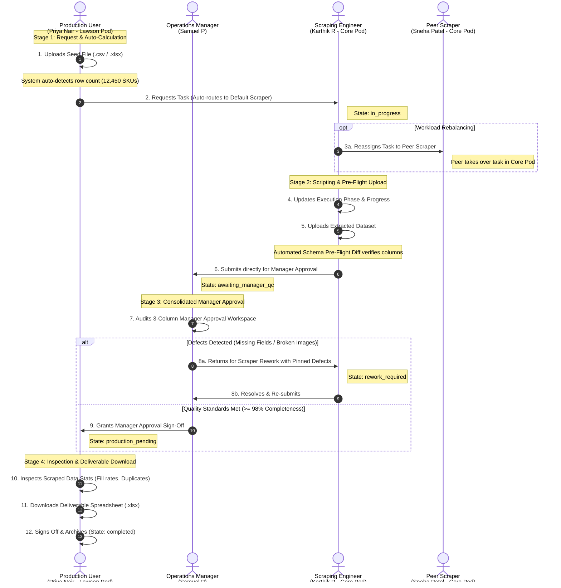

# Scraping Operations Management Portal — Operational Workflow Specification

> **Target System:** Scraping Operations Management Portal (Vserve Enterprise SaaS)  
> **Status:** Approved Architecture Blueprint  
> **Workforce Structure:** 1 Core Scraping Pod • Multiple Production Teams • Operations Manager Quality Sign-Off

---

## 1. Executive Summary & Architecture Philosophy

The **Scraping Operations Management Portal** is an enterprise data-extraction operating system designed for high-throughput product catalog harvesting (500k+ SKUs).

### Consolidated Role Hierarchy (Zero Separate QC User)

```
┌──────────────────────────────────────┐       ┌──────────────────────────────────────┐       ┌──────────────────────────────────────┐
│     MULTIPLE PRODUCTION TEAMS        │       │         OPERATIONS MANAGER           │       │    1 CORE SCRAPING ENGINEERING POD   │
│  (Lawson, Surya, DTS, Altius Pods)   │       │          (Lead: Samuel P)            │       │   (Karthik R, Sneha, Rajesh, Ananya) │
│                                      │       │                                      │       │                                      │
│ • Requests Tasks with Seed File      │◄─────►│ • Workload & Capacity Triage         │◄─────►│ • Develops Playwright/Scrapy Scripts  │
│ • Auto-Detects SKU Count from Upload │       │ • Assigns/Reassigns Scraping Pod     │       │ • Manages Execution Phases & Progress│
│ • Auto-Routes to Default Scraper     │       │ • Dedicated 3-Column Manager QC      │       │ • Uploads Scraped Output File        │
│ • Inspects Attribute Stats           │       │ • Grants Approval or Triggers Rework │       │ • Schema Pre-Flight Diff Engine      │
│ • Downloads Deliverable (.xlsx)      │       │ • Configures Team User Assignments   │       │ • Reassigns Tasks to Peer Scrapers   │
└──────────────────────────────────────┘       └──────────────────────────────────────┘       └──────────────────────────────────────┘
```

1. **Multiple Production Teams & Users (Task Initiators & Deliverable Consumers):**
   - Distinct Production Pods manage specific client accounts (e.g., Lawson Production Team, Surya Production Team, DTS Automation Team, Altius Enterprise Team).
   - Users: Priya Nair, Surya Prakash, David Chen, Arun Kumar.
   - **Frictionless Task Creation:** Production users do NOT need to manually select scraping developers. Tasks can automatically route to the configured **Default Scraping Assignee** (e.g. Karthik R) or be submitted for Operations Manager triage.
   - **Automated SKU Count:** Uploading any `.csv` or `.xlsx` seed file automatically calculates and populates the Estimated SKU Count.
   - **Quality Inspection & Download:** Production teams review attribute fill rates, duplicate metrics, and download clean deliverable files for client handoff.

2. **Operations Manager (Portfolio Orchestrator & Quality Authority):**
   - User: Samuel P.
   - Does **NOT** need "My Tasks" (oversees all teams, portfolio health, and cross-pod rebalancing).
   - Audits scraped datasets in the 3-column workspace (Left: Task Specs | Center: 10 Completeness Gauges | Right: Decision Panel).
   - **Consolidated Approval Authority:** Replaces the separate QC role. Approves datasets directly to Production or triggers Rework with pinned defect tags.
   - Sets Default Scraping Assignee and manages Production Team user assignments.

3. **1 Core Scraping Engineering Pod (Extraction Engine):**
   - Lead: Karthik R. Engineers: Sneha Patel, Rajesh Varma, Ananya Joshi.
   - Receives tasks via personal worklists (`My Tasks`).
   - Manages execution phases (DOM Analysis → Scripting → Proxy Harvesting → Normalization).
   - **Peer Reassignment:** Scrapers can reassign assigned tasks to colleague scrapers in the Core Pod if overloaded.
   - **Automated Schema Pre-Flight Diff:** Uploads output `.xlsx`/`.csv` files, and the system automatically checks mandatory columns (`✓ Matches Header` vs `✗ Header Missing`) before permitting submission for Manager Approval.

---

## 2. End-to-End Operational Lifecycle Diagram



---

## 3. UI Navigation & View Architecture

| Route ID | Label | Target Persona | View Purpose |
| :--- | :--- | :--- | :--- |
| `overview` | **Overview** | Operations Manager & Leads | Executive Operations Dashboard: 8 KPI cards, sparklines, 5 Recharts visualizations (weekly velocity, team productivity, status donut, approval trends, daily SKU volume). |
| `all-tasks` | **All Tasks** | All Internal Roles | Dedicated Linear/Vercel-style Task Master Registry: Multi-tab status filters, multi-faceted filtering (Production Pod, Scraper, Priority), search, bulk assign, export CSV, and slide-over inspector drawer. |
| `my-tasks` | **My Tasks** | Scraping Engineers only | Personal extraction worklist, phase/progress updater, peer reassignment modal, file upload with schema pre-flight diff, submit for Manager Approval. |
| `manager-qc` | **Manager Approval** | Operations Manager | Consolidated 3-column Quality Control workspace: Task requirements, 10 attribute fill-rate gauges with click-to-filter, and sign-off decision panel. |
| `production-qc` | **Production Deliverables** | Production Teams | Request Scraping Task modal trigger, Scraped Data Stats modal, Download Scraped File (.xlsx/.csv), and Client Sign-Off. |
| `teams` | **Teams & Pods** | Operations Manager & Leads | Governance directory showing the 1 Core Scraping Pod, 4 Production Teams, capacity meters, and dynamic user team reassignment. |
| `settings` | **Settings** | All Roles | Theme toggle, Default Scraping Assignee configuration, and Production User Team assignment. |

---

## 4. Key Implementation Files

- **Task Registry View (Linear/Vercel Grid):** [AllTasksView.tsx](file:///D:/Office%20WFH/Web%20Scrap/Vserve%20Scraping/Scraping%20Team%20portal/src/components/views/AllTasksView.tsx)
- **Executive Operations Dashboard:** [ManagerDashboardView.tsx](file:///D:/Office%20WFH/Web%20Scrap/Vserve%20Scraping/Scraping%20Team%20portal/src/components/views/ManagerDashboardView.tsx)
- **Scraper Task Worklist & Peer Reassignment:** [MyTasksScraperView.tsx](file:///D:/Office%20WFH/Web%20Scrap/Vserve%20Scraping/Scraping%20Team%20portal/src/components/views/MyTasksScraperView.tsx)
- **Auto-Calculated Task Creation Modal:** [TaskAssignmentModal.tsx](file:///D:/Office%20WFH/Web%20Scrap/Vserve%20Scraping/Scraping%20Team%20portal/src/components/views/TaskAssignmentModal.tsx)
- **Team Governance & Pod Allocation:** [TeamsView.tsx](file:///D:/Office%20WFH/Web%20Scrap/Vserve%20Scraping/Scraping%20Team%20portal/src/components/views/TeamsView.tsx)
- **System Settings & Default Scraper Routing:** [SettingsView.tsx](file:///D:/Office%20WFH/Web%20Scrap/Vserve%20Scraping/Scraping%20Team%20portal/src/components/views/SettingsView.tsx)
- **Application State Store:** [AppContext.tsx](file:///D:/Office%20WFH/Web%20Scrap/Vserve%20Scraping/Scraping%20Team%20portal/src/context/AppContext.tsx)
- **Navigation & Role-Based Visibility:** [Sidebar.tsx](file:///D:/Office%20WFH/Web%20Scrap/Vserve%20Scraping/Scraping%20Team%20portal/src/components/layout/Sidebar.tsx)
